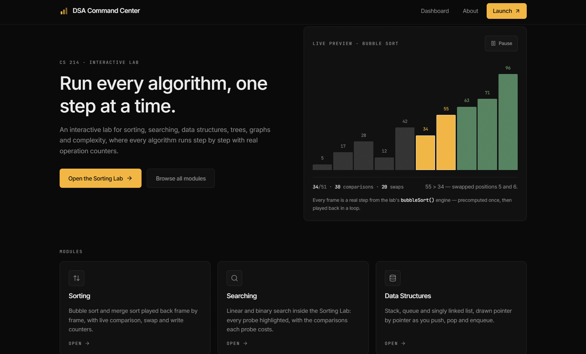
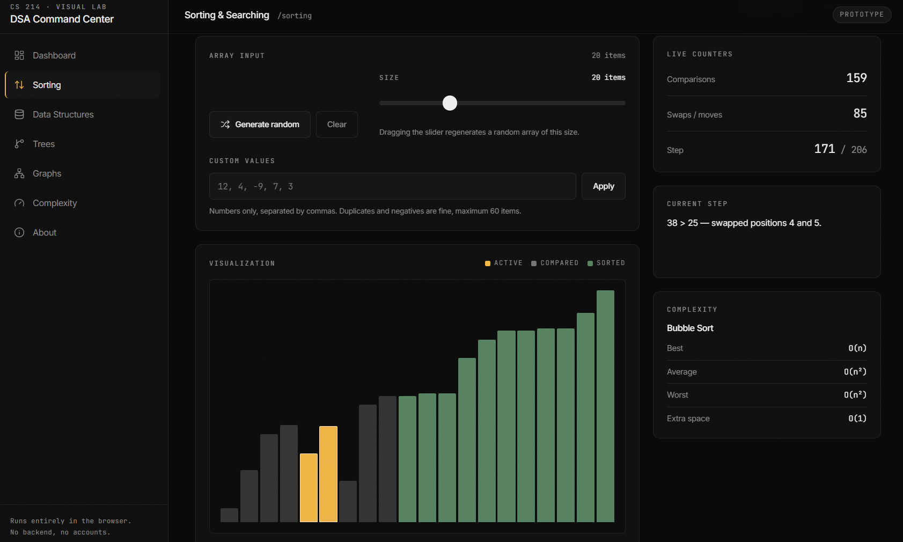
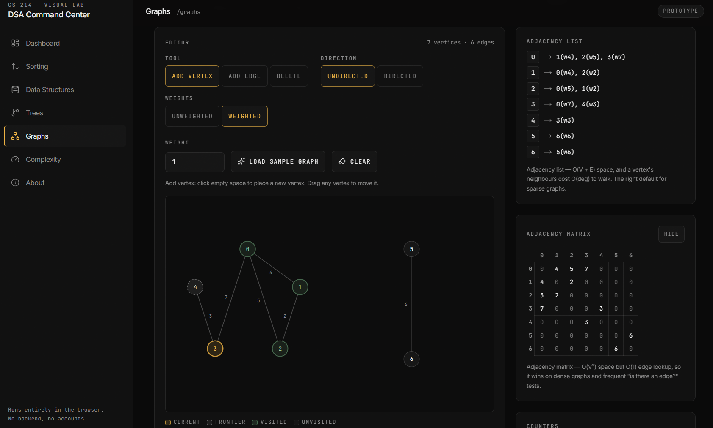
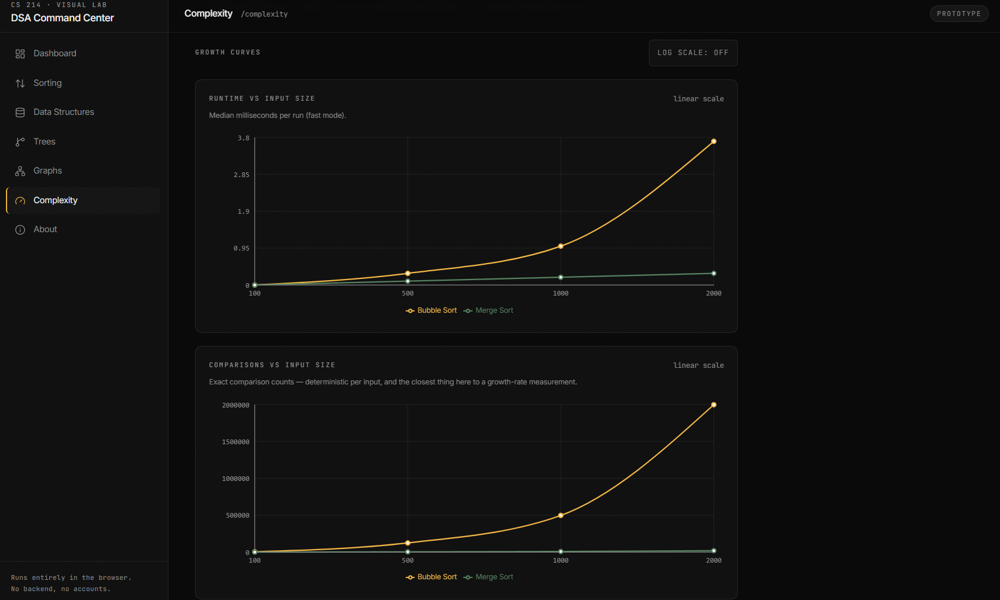
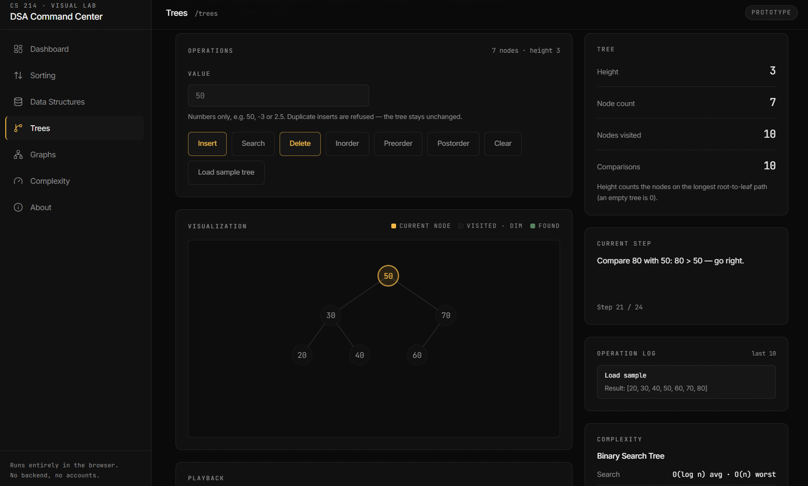

# DSA Command Center

Live: https://supreme-dsa.vercel.app

An interactive visual lab for Data Structures and Algorithms (CS 214). Every algorithm
runs in the browser as a pure function that emits its whole step stream up front; the
interface then plays that stream back one index at a time. Counters and drawings are both
derived from the same recorded steps, so nothing is a black box.

Built with Next.js 15 (App Router), React 19, TypeScript (strict) and Tailwind CSS v4.
Fully static, no backend, no accounts, no data leaves the machine (saved benchmark runs
live in `localStorage`).

Routes are split into two route groups: the landing page at `/` renders in `(marketing)`
with its own minimal layout (no sidebar), and everything else — dashboard, labs and about —
renders in `(app)` inside the existing app shell, starting at `/dashboard`.

## Modules

| Route | Module | What it does |
| --- | --- | --- |
| `/` | Landing | Wordmark, hero with a live preview driven by the real bubble sort engine, the module grid and a "how it works" summary. |
| `/dashboard` | Dashboard | Module directory + recently saved benchmark experiments. |
| `/sorting` | Sorting & Searching | Bubble and merge sort; linear and binary search, with live comparison / swap / write counters and a bar chart. |
| `/data-structures` | Data Structures | Stack, queue and singly linked list, drawn pointer by pointer. |
| `/trees` | Trees | A binary search tree with insert, search, delete and inorder / preorder / postorder traversals. |
| `/graphs` | Graphs | An SVG graph editor with BFS / DFS playback, live frontier and visit order, BFS distances, and adjacency-list / matrix views. |
| `/complexity` | Complexity | A recursion visualizer (call stack + Fibonacci call tree) and a seeded benchmark center. |
| `/about` | About | The step model, module list, tech stack and how to run it. |

## The step model

The one rule that shapes the codebase:

- Algorithms are **pure TypeScript** — no React, no DOM, no globals, no I/O.
- Each takes an input, **copies it** (never mutating the caller's value), and returns
  `{ result, steps, counters }`.
- Each entry in `steps` is an **immutable snapshot** of one frame: the array, the
  highlighted indices, the current node, the pointers, a human-readable description.
- Components hold a single current-step index from `usePlayback` and render whatever that
  step contains. Because history is never rewritten in place, scrubbing backwards is exact.

This is also why the labs share one set of playback controls, one bar chart and one
inspector: they all consume the same shape of step stream, whether it came from a sort, a
traversal or a recursive call.

Invalid input is part of the contract too: operations return an `error` string and never
throw, and where it matters (binary search on unsorted input, duplicate BST inserts) the
UI surfaces the refusal with a suggested fix instead of pretending something ran.

## Counters

Each module reports counters derived from its steps. The **exact** definition of every
comparison, swap, write, pointer change, visit and call is documented per algorithm in
[`docs/COUNTERS.md`](docs/COUNTERS.md).

The short version: counters are deterministic for a given input, so comparison counts are
exact; wall-clock timings are not, and they never prove Big-O.

## Benchmark method

The benchmark runs on the **main thread** (no Web Workers): every timed trial blocks the
browser's single JS thread, and `runBenchmark` yields back to it (`setTimeout(0)`) between
trials so the page can repaint and stay responsive. Those yields — plus whatever else the
browser is doing — are part of every measurement, which is another reason the timings are
indicative and never proof of Big-O.

That is also why the size presets are capped: `PRESET_SIZES` stops at 2 000 values and
`MAX_BENCHMARK_SIZE` at 5 000. A single O(n²) trial over a much larger input would freeze
the tab for seconds between two yields, and past a few thousand values the noise from GC
and background browser work swamps any difference the chart could show.

## Getting started

Requires **Node 20** (see [`.nvmrc`](.nvmrc)).

```bash
npm install
npm run dev        # http://localhost:3000
```

### Scripts

| Script | Runs | Purpose |
| --- | --- | --- |
| `npm run dev` | `next dev` | Development server. |
| `npm run build` | `next build` | Production build. |
| `npm start` | `next start` | Serve the production build. |
| `npm run lint` | `eslint .` | Lint. |
| `npm run typecheck` | `tsc --noEmit` | Type-check (strict, no unused locals/parameters). |
| `npm test` | `vitest run` | Unit tests. |
| `npm run check` | lint → typecheck → test → build | Everything, in order. CI's single command. |

## Project structure

```
src/
  app/                    Routes (App Router); metadata + layout + error/not-found
    (marketing)/          Landing page at `/` — its own minimal layout, no sidebar
    (app)/                Everything else inside the AppShell: dashboard, labs, about
  components/
    controls/             PlaybackControls, RangeControl, SegmentedControl (shared)
    layout/               AppShell, Sidebar, TopBar
    marketing/            Landing-only components (the live hero sort preview)
    visualizers/          One lab per module + their visualizers (BarChart, TreeVisualizer, GraphCanvas, ...)
  algorithms/             Pure engines, one folder per module
    sorting/ searching/ data-structures/ trees/ graphs/ recursion/
  hooks/                  usePlayback, usePrefersReducedMotion, useRecentBenchmarkRuns
  lib/                    benchmark, progress, utils, heroPreview (landing hero data), site (site + GitHub URLs)
tests/                    Vitest specs for the pure layer
docs/COUNTERS.md          Exact counter definitions per algorithm
```

Every `src/algorithms/*` folder exports a registry (`sortingAlgorithms`, `recursionFunctions`,
…). Adding an algorithm means adding a file and one registry entry — the UI reads the
registry, so no page changes are needed.

## Testing

The Vitest suite (`npm test`) targets the pure layer only: the algorithm engines, the
playback reducer, the benchmark helpers, the parsers and the landing hero's loop helper. It
asserts the step contract the UI relies on — steps start from the untouched input, end on
the finished result, never mutate their input, and report the counters they promise. The
interactive layer is verified by hand.

## Accessibility notes

- Keyboard reachable with a visible focus ring; `Skip to content` link and
  `nav` / `main` / `aside` landmarks.
- Icon-only buttons carry `aria-label`s; form fields are labelled and tie their errors to
  the input via `aria-describedby` with `role="alert"`.
- The current step is announced with `aria-live="polite"` during playback, and each
  visualization has a text alternative (e.g. "Bar chart of 20 values, step 5 of 38").
- State is never signalled by colour alone — sorted / found / visited / frontier states also
  carry a border, outline, stroke weight or dash pattern, and each visualization has a
  labelled legend.
- `prefers-reduced-motion` is respected everywhere, including the Recharts line animation.
- One `h1` per page.

## Deployment (Vercel)

The app is fully static, so `next.config.mjs` stays at its default (`{}`) — no custom
`output`, rewrites or headers are needed. Import the repository into Vercel, keep the default
build command (`next build`) and Node 20 (from `.nvmrc`), and deploy.

To point Open Graph / canonical URLs at a real domain, set:

```
NEXT_PUBLIC_SITE_URL=https://supreme-dsa.vercel.app
```

It defaults to `https://supreme-dsa.vercel.app` (the `SITE_URL` constant in
`src/lib/site.ts`) when unset.

## Author

**Mohamed Bilal** — [https://github.com/mhmdbidda/supreme-dsa](https://github.com/mhmdbidda/supreme-dsa)

## License

This project is licensed under the terms in the [LICENSE](LICENSE) file. See the LICENSE for details.

## Screenshots


*Landing page with a live Bubble Sort preview*


*Sorting Lab with live counters and step description*


*Graph Studio with BFS traversal and adjacency views*


*Benchmark Center growth curves (Bubble vs Merge Sort)*


*Tree Explorer with a Binary Search Tree*
